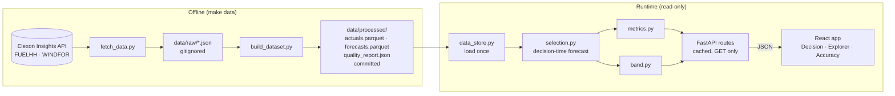

# Wind Forecast Monitor (UK day-ahead procurement)

A GB day-ahead power buyer has to commit volume the day before delivery. This app shows them the wind forecast they actually had at decision time (09:20 UK time on D-1 by default), how it compared with the metered actual, and how wrong that forecast has usually been. It covers purchase decisions made in January 2026, using Elexon BMRS FUELHH (actual wind) and WINDFOR (wind forecast).

| | |
|---|---|
| **Live app** | https://m7qk2x-3ap9.vercel.app |
| **Live API** | https://m7qk2x.vercel.app/api/health (interactive docs: https://m7qk2x.vercel.app/docs) |
| **Video walkthrough** | _Pending: to be added when the video is recorded._ |
| **Source** | https://github.com/SatyamKumarCS/m7qk2x |

## Contents
[Screens](#screens) · [Features](#features) · [Architecture](#architecture) · [Repository layout](#repository-layout) · [Running locally](#running-locally) · [Reproducing the results](#reproducing-the-results) · [Method](#method) · [Key findings](#key-findings) · [Limitations](#limitations) · [Assumptions](#assumptions) · [API](#api) · [Configuration](#environment-variables) · [Deployment](#deployment-vercel) · [Testing](#testing-and-linting) · [Troubleshooting](#troubleshooting) · [Hours](#hours-per-ticket) · [AI tools used](#ai-tools-used) · [Data attribution](#data-source-and-attribution)

## Screens

Captured from the production app on 2026-10-26 (1280 px wide, cutoff 09:20).

**Decision:** one delivery day: the forecast at the cutoff, an 80 % or 90 % planning band, and, once revealed, the actual.


**Forecast vs actual (Explorer):** any range from one day to the whole month, with presets, zoom and the hourly error.


**Accuracy report:** headline metrics, key findings, error breakdowns and the data-quality report.


## Features

- **Decision-time forecast only.** Each hour uses the newest WINDFOR value published at or before the cutoff on the day before delivery. A later run is never used; if none qualifies, the hour stays empty. The cutoff is selectable: EPEX GB 09:20 (default), N2EX 09:50, 06:00, or any `HH:MM`.
- **Planning band.** An empirical 80 % (or 90 %) range for the actual, built from January's own forecast errors at the chosen cutoff, with its observed in-sample and held-out coverage.
- **Decision view:** forecast energy, peak and trough, the run used and its horizon, the band, a reveal-actual toggle, and a one-line verdict (bias and band coverage).
- **Explorer:** whole January, weeks 1–4 and the stormiest week as presets; actual vs forecast lines; error bars (red = forecast too high, blue = too low); MAE and bias for the range.
- **Accuracy report:** MAE, RMSE, P90, nMAE, n and bias; error by forecast horizon, UK hour, wind level and day; a signed-error histogram; low-sample groups greyed out; and the data-quality report.
- **Shareable state.** Every filter is in the URL (`date`, `start`, `end`, `cutoff`, `band`).
- **Honest gaps.** Missing data is shown as a break, never filled or counted as zero. Each chart has an accessible table.
- **Read-only, offline data.** Nothing calls Elexon at runtime; the processed data is committed.

## Architecture



- **Offline pipeline** (`backend/scripts/`): downloads raw Elexon JSON, then builds the processed parquet files and `quality_report.json`. The build is deterministic.
- **Core logic** (`backend/app/`): pure pandas functions. `selection.py` picks the decision-time forecast, `metrics.py` computes errors, metrics and breakdowns, `band.py` builds the planning band. Constants live in `config.py`.
- **API** (`backend/app/`): FastAPI with six `GET` endpoints, query validation (HTTP 422 on bad input), cached responses and a runtime check that no response uses a forecast published after its cutoff.
- **Frontend** (`frontend/src/`): React 19, Vite and Recharts, with URL-driven state and a typed API client.

## Repository layout

| Path | What it holds |
|---|---|
| `backend/app/` | FastAPI app (`main.py`, `routes.py`, `service.py`, `schemas.py`, `data_store.py`, `about.py`) and core logic (`selection.py`, `metrics.py`, `band.py`, `config.py`) |
| `backend/scripts/` | Offline pipeline: `fetch_data.py`, `build_dataset.py`, `run_notebook.py` |
| `backend/data/processed/` | Committed data: `actuals.parquet`, `forecasts.parquet`, `quality_report.json` |
| `backend/data/raw/` | Raw Elexon downloads (gitignored; rebuilt by `make data`) |
| `backend/tests/` | pytest suite: selection rule, metrics, band, dataset build, fetch, API |
| `backend/requirements*.in` → `requirements*.txt` | Direct deps → fully pinned locks (uv, `make lock`) |
| `backend/ruff.toml`, `pytest.ini`, `.python-version` | Tool config; Python 3.12 |
| `backend/Dockerfile`, `.dockerignore` | Backend image for local runs |
| `backend/vercel.json`, `.vercelignore` | Vercel function config and bundle excludes |
| `frontend/src/` | `App.tsx` shell; `pages/` (one per view); `components/` (charts, shared UI); `api/` (typed client); `hooks/`; `utils/` (pure, tested logic); `test/` (fixtures) |
| `frontend/Dockerfile`, `docker/nginx.conf.template` | Frontend image: Vite build served by nginx, `/api` proxied to the backend |
| `frontend/vercel.json` | SPA rewrite to `index.html` |
| `notebooks/` | `01_exploration.ipynb` (data checks, alignment, bias), `02_band_method_evaluation.ipynb` (band and horizon evidence), `reference/` (cross-check values) |
| `screenshots/` | The screen captures above |
| `compose.yaml`, `Makefile` | Docker Compose stack; developer commands |
| `AGENTS.md`, `CLAUDE.md` | Instructions for AI coding agents working on the repo |

## Running locally

### With Docker (one command)

Requires Docker with Compose v2.

```sh
make up      # docker compose up --build
```

Open http://localhost:5173 (app) and http://localhost:8000/api/health (API). `make down` stops the stack. If those ports are taken, move them: `APP_PORT=5180 API_PORT=8010 make up`.

The frontend container serves the built app with nginx and proxies `/api` to the backend container, so the browser stays on one origin. The backend runs with a read-only filesystem, because nothing is written at runtime.

### Without Docker (uv + Node)

Requires [uv](https://docs.astral.sh/uv/) (it fetches Python 3.12 if needed), Node ≥ 22.12 and npm.

```sh
make install                                              # fresh Python 3.12 venv in backend/.venv + pinned deps; npm ci
cd backend && .venv/bin/uvicorn app.main:app --reload --port 8000
cd frontend && npm run dev                                # second terminal; http://localhost:5173
```

The Vite dev server proxies `/api` to `localhost:8000`, so no environment variables are needed. To work on the UI without a backend, set `VITE_API_MOCK=1` in `frontend/.env.local` (fixtures for `/api/health` and `/api/meta` only).

`make install` replaces any existing `backend/.venv`. Stop a running `uvicorn` first.

## Reproducing the results

1. `make install`
2. `make data`: downloads the raw FUELHH and WINDFOR data for the scope window from the Elexon Insights API (no key needed) into `backend/data/raw/`, then rebuilds `backend/data/processed/`. The build is deterministic, so the same raw files give byte-identical outputs and `git status` shows no change. A fresh download only differs if Elexon has since revised the data.
3. `make test`: the backend tests include checks against the committed real data (metrics and band numbers).
4. `make notebook`: re-runs both notebooks from a clean kernel, regenerating their outputs and figures.
5. Start the app (above) and compare the Accuracy report with the [Key findings](#key-findings) below.

## Method

1. **Scope.** Decision days 1–31 January 2026, so delivery days 2 January–1 February 2026 (UK calendar days). UK time equals UTC throughout.
2. **Selection.** For a target hour t on delivery day D, the cutoff is D − 1 at the cutoff clock (UK time). The forecast used is the WINDFOR value with the latest publish time ≤ cutoff (inclusive). There is no fallback to a later run. With 8 runs a day, the 09:20 cutoff uses the 07:30 UTC run, 16.5–39.5 h ahead of each hour.
3. **Alignment.** WINDFOR is hourly and FUELHH half-hourly. Each hourly forecast is compared with the half-hour that starts at the same time (point alignment). Actuals are never interpolated or filled. A pair counts only when both values exist.
4. **Error.** `error = forecast − actual`, so positive means the forecast was too high. Metrics: MAE, RMSE, bias, median, P90/P95 and max absolute error, nMAE, WAPE and Pearson r. MAPE is never a headline (actuals can approach zero). Groups with fewer than 30 hours are flagged as low sample.
5. **Horizon breakdown.** Buckets `[0,6) [6,12) [12,24) [24,36) [36,48) [48,72)` h over every forecast run, so this chart does not depend on the cutoff.
6. **Planning band.** Empirical quantiles (type 7) of the signed errors over all in-scope days at the selected cutoff. The 80 % band is `lower = max(0, F − Q(0.90))`, `upper = max(0, F − Q(0.10))`; the 90 % band uses Q(0.05) and Q(0.95). The band is asymmetric because the errors are. Coverage is reported in-sample and on held-out days (each day calibrated only on days ≤ D − 2). It is observed, not guaranteed.
7. **Energy.** Forecast and actual MWh are summed over valid hours only. A missing hour is never treated as zero.

## Key findings

At the 09:20 cutoff, over delivery days 2 January–1 February 2026 (744 hourly points, none missing). Values are from the production API.

- **Typical miss: about 2.0 GW per hour.** MAE 2,022 MW, median absolute error 1,655 MW, RMSE 2,497 MW, P90 4,154 MW, max 6,894 MW. nMAE 17.9 %. Correlation r = 0.932.
- **The forecast runs high.** Bias +1,746 MW (about 15 % of metered output). The forecast was above the actual in 630 of 744 hours. The gap persists even 0–3 h ahead, so it is not ordinary forecast error. Its cause is unknown (see [Limitations](#limitations)).
- **The cutoff barely matters within the morning.** MAE is 2,022 MW at 09:20, 1,996 MW at 09:50 and 2,003 MW at 06:00.
- **Error grows with horizon.** Over all runs, MAE rises from 1,681 MW at 0–6 h ahead to 2,234 MW at 36–48 h and 2,307 MW at 48–72 h.
- **By wind level** (grouped by actual), error is largest below 5 GW (MAE 2.3 GW, 61 hours) and smallest at 5–10 GW (1.7 GW, 247 hours).
- **The 80 % band** spans F − 4,154 MW to F + 426 MW. It held 79.8 % of hours in-sample and 78.4 % on held-out days. On individual days coverage ranges from 0 % to 100 %, and misses are mostly on the low side (the actual falls below the band).
- **Data quality:** 1,536 of 1,536 half-hours of actuals kept; 15,775 hourly forecast values from 272 runs kept, after dropping 4,081 values published after their own target time. No duplicates, nulls, negatives or implausible spikes.

## Limitations

- **Metered wind only.** Both datasets cover wind farms with operational metering, about 82 % of GB wind according to NESO. Embedded generation is excluded.
- **Unexplained level gap.** The forecast averages about 15 % above metered outturn. Curtailment and a fleet or scale difference both fit the evidence, and these two datasets cannot separate them. The app reports the bias separately and says the cause is unknown.
- **Timestamp meaning.** Elexon does not document which instant a WINDFOR value represents. Point alignment was chosen. Centred alignment fits marginally better (MAE 2,004 vs 2,022 MW), an effect under 1 %.
- **One winter month.** All numbers describe January 2026. The band is calibrated on the same month it is shown for, its held-out coverage (78.4 %) sits a little below the nominal 80 %, and it is not conditioned on hour or wind level.
- **Long horizons are partial.** The 48–72 h bucket covers only 19 of 24 UK hours, because every run ends at 21:00 UTC two days after publication.
- **Missing-data paths are untested on real data.** The January data has no missing hours, so gap handling is covered by unit tests only.
- **Small daily samples.** Each day has 24 points, below the 30-point low-sample threshold, so daily figures show a pattern rather than a reliable per-day accuracy.
- **Static snapshot.** There is no live data mode; changing the period means re-running `make data`.
- **Preview deployments.** The backend allows only the production frontend origin, so Vercel preview URLs of the frontend cannot call the API.
- **Not yet measured in production:** see [Deployment](#deployment-vercel).

## Assumptions

The main working assumptions, in short:

- The default cutoff is 09:20 UK time (EPEX GB day-ahead auction close), and the cutoff is inclusive. Which auction the team trades (09:20 or 09:50) is still to be confirmed, so the cutoff is a setting.
- "Purchase decisions made in January 2026" means decision days in January, so delivery runs 2 January–1 February. If it means delivery days in January, only the config changes.
- UK time equals UTC in scope; times are stored in UTC and shown as UK time.
- Evaluation is hourly (the forecast's resolution). Error is forecast minus actual.
- The band is calibrated in-sample on January, with held-out coverage reported alongside.
- Only Elexon data is used: no weather or capacity data. An implausible-spike flag therefore uses a fixed 30,000 MW threshold.
- API JSON uses camelCase. API date ranges default to the whole scope.

The full list, with the open questions and the reasoning behind each decision, is kept in the project's planning docs, which the owner keeps outside the published repository.

## API

All endpoints are `GET` and read-only. Dates are `YYYY-MM-DD` (inclusive, default: the whole scope); `cutoff` is `HH:MM` UK time (default `09:20`). Invalid input returns **422** `{"detail": "…"}`. Times in responses are UTC ISO-8601; power is MW.

| Endpoint | Returns |
|---|---|
| `/api/health` | Status, whether data loaded, row counts and the data's date range |
| `/api/meta` | Scope, default cutoff and presets, publish schedule, assumptions, sources and the quality report |
| `/api/timeseries?start&end&cutoff` | One point per half-hour: actual, decision-time forecast, publish time, horizon and error |
| `/api/metrics?start&end&cutoff` | Headline metrics and counts (n, missing forecast, missing actual) |
| `/api/breakdown?by=horizon\|hour\|level\|day&start&end&cutoff` | Per-group n, MAE, RMSE, bias, P90 and the low-sample flag (`by=horizon` ignores `cutoff`) |
| `/api/band?date&cutoff&level=80\|90` | Hourly forecast with the planning band, calibration details and the day summary |

Example: https://m7qk2x.vercel.app/api/metrics?start=2026-01-02&end=2026-02-01&cutoff=09:20. Interactive schema: `/docs` on the API.

## Environment variables

| Variable | Where | Default | Purpose |
|---|---|---|---|
| `CORS_ORIGINS` | Backend | `http://localhost:5173` | Comma-separated browser origins allowed to call the API. Exact match: `https://…`, no trailing slash. |
| `PORT` | Backend and frontend containers | `8000` / `8080` | Port the container listens on |
| `VITE_API_URL` | Frontend, **build time** | empty (same origin) | Backend base URL without `/api` and without a trailing slash |
| `VITE_API_MOCK` | Frontend, dev only | empty | `1` serves fixture data for `/api/health` and `/api/meta` |
| `API_UPSTREAM` | Frontend container | `http://backend:8000` | Where nginx proxies `/api` |
| `APP_PORT`, `API_PORT` | `compose.yaml` | `5173`, `8000` | Host ports for `make up` |

There are no secrets: the app needs no API keys.

## Deployment (Vercel)

Production runs as two Vercel projects connected to this GitHub repository, deployed by the owner on 2026-10-26.

| | Frontend | Backend |
|---|---|---|
| URL | https://m7qk2x-3ap9.vercel.app | https://m7qk2x.vercel.app |
| Root directory | `frontend` | `backend` |
| Runtime | Static Vite build (`npm run build` → `dist`) | Python function serving the FastAPI `app` in `app/main.py`, installed from `requirements.txt`; Python version pinned to 3.12 in `.python-version` (not yet confirmed from the build log) |
| Build / install / output overrides | None (framework defaults) | None (framework defaults) |
| Config in repo | `vercel.json`: rewrite every path to `/index.html`, so `/explorer` and `/accuracy` load directly | `vercel.json`: excludes tests, scripts, raw data and caches from the function bundle; `.vercelignore` for CLI uploads |
| Environment variable | `VITE_API_URL=https://m7qk2x.vercel.app` | `CORS_ORIGINS=https://m7qk2x-3ap9.vercel.app` |

Notes:
- Never add a `backend/pyproject.toml`: Vercel would install from it and ignore `requirements.txt`.
- `VITE_API_URL` is baked in at build time, and `CORS_ORIGINS` is read at startup, so changing either needs a redeploy of that project.
- The function runs in Vercel's `iad1` region.

**Verified on 2026-10-26** from outside, with no Vercel login: both URLs load; `/api/health` reports the data loaded (1,536 actual rows, 15,775 forecast rows); CORS allows exactly the frontend origin; a custom cutoff works and bad input returns 422; the Decision, Explorer and Accuracy browser test suites pass against production (16/16, 24/24, 19/19). Warm first load took 0.53–0.57 s from navigation to a rendered chart (5 runs, HTTP cache disabled), and warm API calls 0.32–0.38 s from India. Two earlier first loads in a new browser session were slow (6.6 s, and one that did not render within 15 s); the cause was not diagnosed.

**Still pending:** the deployed function bundle size, a measured cold start, the Python version shown in the build log, the Vercel plan, and the manual production checklist. They will be added here once recorded.

## Testing and linting

```sh
make test     # backend pytest, then frontend Vitest (run with TZ=Asia/Kolkata to catch date shifts)
make lint     # ruff check + format check; ESLint + Prettier check
make format   # apply ruff and Prettier fixes
make lock     # re-pin backend deps from requirements*.in (never edit the .txt files by hand)
```

On 2026-10-26: 150 backend tests and 87 frontend tests pass on Python 3.12, and lint is clean. The tests pin the cutoff rule (no forecast published after the cutoff is ever used), the metrics and band against the committed data, and API validation.

## Troubleshooting

| Symptom | Fix |
|---|---|
| Browser console: "blocked by CORS policy" | `CORS_ORIGINS` on the backend must equal the frontend origin exactly (`https://…`, no trailing slash). Redeploy the backend after changing it. |
| The deployed frontend calls the wrong API | `VITE_API_URL` is set at build time. Fix it on the frontend project and redeploy. |
| "Waking up the server…" on first load | The API is starting after being idle. The message appears after 3 s; wait, or press Retry if the check fails. |
| `make up`: port already allocated | `APP_PORT=5180 API_PORT=8010 make up` |
| `make test` fails on a fresh checkout or after the Python 3.12 move | Run `make install` to rebuild `backend/.venv` with Python 3.12 (stop any running `uvicorn` first). |
| `make install`: uv not found | Install uv: https://docs.astral.sh/uv/getting-started/installation/ |
| `npm ci` engine error | Use Node 22.12 or newer. |
| API answers 503 "Data is not available right now." | The processed parquet files are missing or unreadable. Restore `backend/data/processed/` from git or run `make data`. |

## Hours per ticket

The brief caps the work at 16 hours. Estimates come from the project backlog. **Actual hours were not recorded per ticket; the owner will fill in this column.**

| # | Ticket | Estimate (h) | Actual (h) |
|---|---|---|---|
| 001 | Confirm Elexon API and data shape | 1.0 | _to fill_ |
| 002 | Scaffold repo skeleton | 0.5 | _to fill_ |
| 003 | Deploy spike and backend host choice | 0.75 | _to fill_ |
| 004 | Forecast selection engine | 0.75 | _to fill_ |
| 005 | Fetch raw Elexon data | 0.75 | _to fill_ |
| 006 | Build processed dataset and quality report | 0.75 | _to fill_ |
| 007 | Exploration notebook and sanity checks | 2.0 | _to fill_ |
| 008 | Lock alignment, horizon buckets and band method | 0.5 | _to fill_ |
| 009 | Metrics engine and breakdowns | 0.75 | _to fill_ |
| 010 | Planning band | 0.5 | _to fill_ |
| 011 | Backend API | 1.25 | _to fill_ |
| 012 | Frontend shell | 1.0 | _to fill_ |
| 013 | Decision view | 1.0 | _to fill_ |
| 014 | Explorer view | 0.75 | _to fill_ |
| 015 | Accuracy report view | 0.75 | _to fill_ |
| 016 | Docker and production deploy | 1.0 | _to fill_ |
| 017 | README and submission docs | 0.5 | _to fill_ |
| 018 | Record video and submit | 1.0 | _to fill_ |
| | **Total** (plus 0.5 h buffer) | **15.5** | _to fill_ |

Not done (optional stretch): CI workflow, CSV export.

## AI tools used

- **Claude Code** (Anthropic's coding agent, running Claude models) was used throughout: researching the Elexon API, drafting the planning docs and decision records, writing the backend, frontend, tests, notebooks, Docker and Vercel configuration, running checks and reviews, and drafting this README.
- The owner made the method and hosting decisions, reviewed every change before it was committed, and set up and deployed the Vercel projects.

## Data source and attribution

Data: Elexon BMRS via the Insights API: [FUELHH](https://bmrs.elexon.co.uk/api-documentation/endpoint/datasets/FUELHH/stream) (actual generation by fuel type, wind only) and [WINDFOR](https://bmrs.elexon.co.uk/api-documentation/endpoint/datasets/WINDFOR/stream) (wind generation forecast).

Contains BMRS data © Elexon Limited copyright and database right 2026. Used under the [BMRS data licence](https://www.elexon.co.uk/data/balancing-mechanism-reporting-agent/copyright-licence-bmrs-data/). This project is not affiliated with or endorsed by Elexon.
