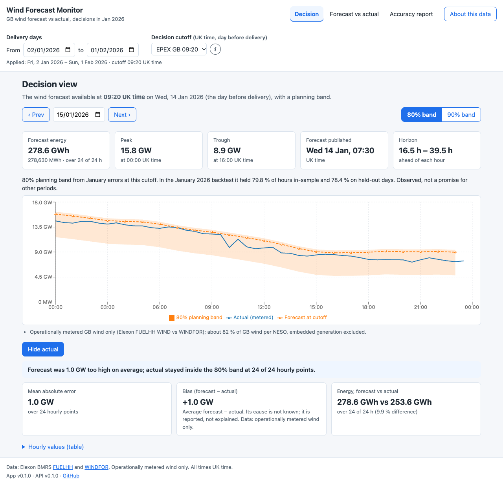
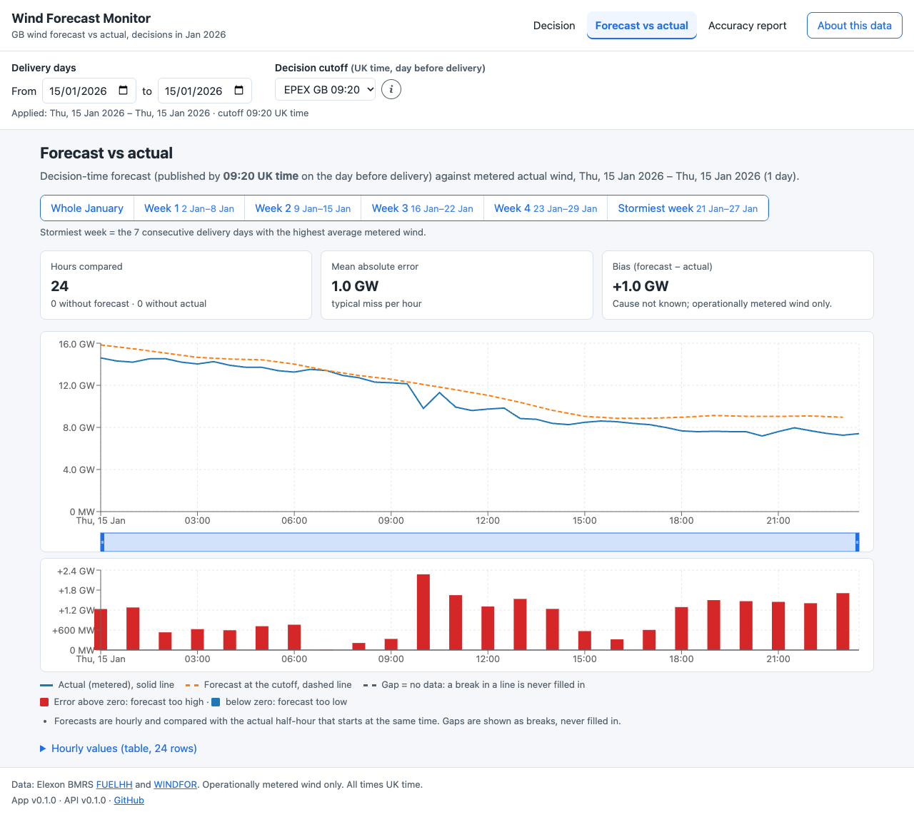
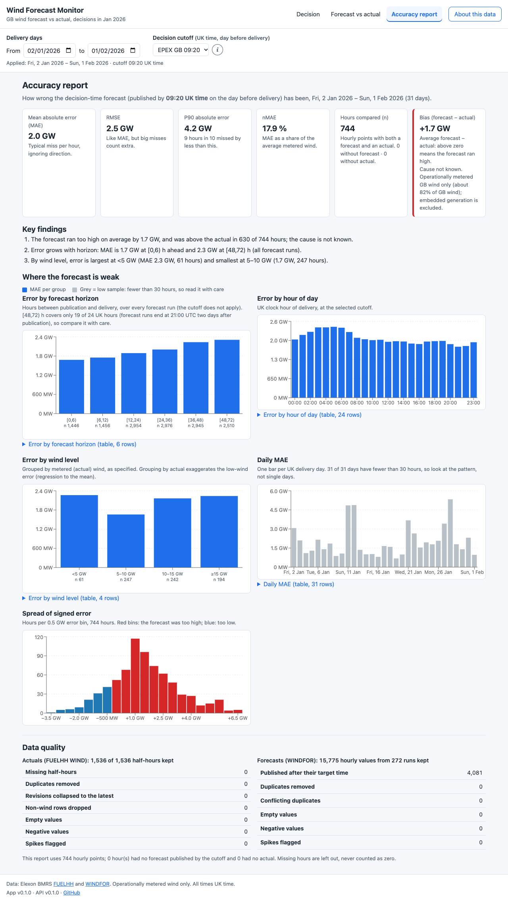
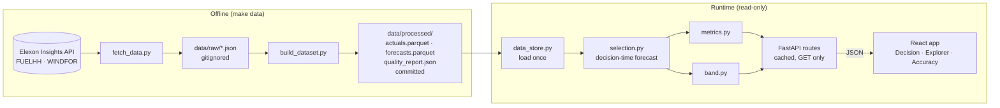

# Wind Forecast Monitor (UK day-ahead procurement)

A GB day-ahead power buyer commits volume the day before delivery. This app shows them the wind forecast they actually had at decision time (09:20 UK time on D-1 by default), how it compared with the metered actual, and how wrong that forecast has usually been. It covers purchase decisions made in January 2026, using Elexon BMRS FUELHH (actual wind) and WINDFOR (wind forecast).

- **Live app:** https://m7qk2x-3ap9.vercel.app
- **Live API:** https://m7qk2x.vercel.app/api/health (interactive docs: https://m7qk2x.vercel.app/docs)
- **Video walkthrough:** _Pending: to be added when the video is recorded._
- **Source:** https://github.com/SatyamKumarCS/m7qk2x

## Screens

Captured from production on 2026-10-26 (1280 px wide, cutoff 09:20).

| Decision | Forecast vs actual | Accuracy report |
|---|---|---|
|  |  |  |
| One delivery day: forecast at the cutoff, 80 % or 90 % planning band, reveal-actual toggle, one-line verdict | Any range with presets (whole January, weeks 1–4, stormiest week), zoom and hourly error bars | MAE, RMSE, P90, nMAE, n and bias; error by horizon, hour, wind level and day; data quality |

## Features

- **Decision-time forecast only:** each hour uses the newest WINDFOR value published at or before the cutoff on the day before delivery, never a later run. Cutoff presets: EPEX GB 09:20 (default), N2EX 09:50, 06:00, or any `HH:MM`.
- **Planning band:** an empirical 80 % or 90 % range for the actual, with its observed in-sample and held-out coverage.
- **Honest gaps:** missing data is shown as a break, never filled or counted as zero; every chart has an accessible table.
- **Shareable state:** every filter is in the URL. **Read-only:** nothing calls Elexon at runtime; the processed data is committed.

## Architecture



- **Offline pipeline** (`backend/scripts/`): downloads raw Elexon JSON, then builds the processed parquet files and `quality_report.json`. The build is deterministic.
- **Core logic** (`backend/app/`): pure pandas functions. `selection.py` picks the decision-time forecast, `metrics.py` computes errors, metrics and breakdowns, `band.py` builds the planning band. Constants live in `config.py`.
- **API** (`backend/app/`): FastAPI with six `GET` endpoints, query validation (HTTP 422 on bad input), cached responses and a runtime check that no response uses a forecast published after its cutoff.
- **Frontend** (`frontend/src/`): React 19, Vite and Recharts, with URL-driven state and a typed API client.

## Files and directories

| Path | Contents |
|---|---|
| `backend/data/processed/` | Committed `actuals.parquet`, `forecasts.parquet`, `quality_report.json` |
| `backend/tests/`, `frontend/src/**/*.test.ts(x)` | pytest and Vitest suites |
| `notebooks/` | Data exploration and band-method evaluation |
| `screenshots/` | The screen captures above |
| `compose.yaml`, `*/Dockerfile`, `*/vercel.json`, `Makefile` | Docker, Vercel and developer commands |

## Running and testing locally

```sh
make up                # Docker: app http://localhost:5173, API http://localhost:8000 (make down to stop)
make install           # without Docker (uv + Node ≥ 22.12): Python 3.12 venv + pinned deps; npm ci
cd backend && .venv/bin/uvicorn app.main:app --reload --port 8000
cd frontend && npm run dev   # second terminal; http://localhost:5173
make test              # pytest + Vitest (TZ=Asia/Kolkata)
make lint              # ruff + ESLint + Prettier
```

[uv](https://docs.astral.sh/uv/) fetches Python 3.12 if needed. On 2026-10-26, 150 backend and 87 frontend tests pass on Python 3.12, and lint is clean. To reproduce the results: `make data` re-downloads the raw Elexon data and rebuilds the processed files (deterministic, so `git status` shows no change unless Elexon revised the data), `make test` checks the metrics and band against the committed data, and `make notebook` re-runs both notebooks.

**Troubleshooting:** a CORS error means `CORS_ORIGINS` doesn't match the frontend origin exactly (then redeploy the backend). If tests fail after the Python 3.12 move, stop `uvicorn` and run `make install`. If a port is taken, use `APP_PORT=5180 API_PORT=8010 make up`.

## Method

- **Scope:** decision days 1–31 January 2026, so delivery days 2 January–1 February 2026 (UK time equals UTC throughout).
- **Selection:** cutoff = D − 1 at the cutoff clock (UK time); the forecast used has the latest publish time ≤ cutoff, with no fallback. At 09:20 this is the 07:30 UTC run, 16.5–39.5 h ahead.
- **Comparison:** each hourly forecast against the FUELHH half-hour starting at the same time; a pair counts only when both values exist. `error = forecast − actual` (positive = too high). MAPE is never a headline; groups under 30 hours are flagged low sample.
- **Band:** type-7 empirical quantiles of January's errors at the selected cutoff; 80 % = `[max(0, F − Q(0.90)), max(0, F − Q(0.10))]`. Coverage is observed in-sample and on held-out days (calibrated on days ≤ D − 2), not guaranteed.

**Assumptions:** the default cutoff is 09:20 (EPEX GB) and inclusive; "decisions made in January" means decision days; evaluation is hourly; only Elexon data is used. Which auction the team trades and the scope reading are still to be confirmed, so both are config values. The full list is in the owner's local planning docs.

## Key findings

At 09:20, delivery days 2 January–1 February 2026, 744 hourly points with none missing (from the production API):

- **Typical miss about 2.0 GW:** MAE 2,022 MW, median 1,655 MW, RMSE 2,497 MW, P90 4,154 MW, max 6,894 MW; nMAE 17.9 %; r = 0.932.
- **The forecast runs high:** bias +1,746 MW (about 15 %), above the actual in 630 of 744 hours, even 0–3 h ahead. Cause unknown.
- **The cutoff barely matters:** MAE 2,022 MW at 09:20, 1,996 MW at 09:50, 2,003 MW at 06:00.
- **Error grows with horizon:** MAE 1,681 MW at 0–6 h → 2,234 MW at 36–48 h → 2,307 MW at 48–72 h (all runs).
- **By wind level:** largest below 5 GW (MAE 2.3 GW, 61 hours), smallest at 5–10 GW (1.7 GW, 247 hours).
- **80 % band:** F − 4,154 MW to F + 426 MW; held 79.8 % of hours in-sample and 78.4 % on held-out days. Daily coverage ranges from 0 % to 100 %; misses are mostly on the low side.
- **Data quality:** all 1,536 actual half-hours kept; 15,775 forecast values from 272 runs kept after dropping 4,081 published after their target time; no duplicates, nulls, negatives or spikes.

## Limitations

- **Metered wind only:** about 82 % of GB wind (NESO); embedded generation is excluded.
- **Unexplained ~15 % level gap:** curtailment and a fleet or scale difference both fit, and these datasets cannot separate them.
- **Timestamp meaning undocumented:** centred alignment fits marginally better than the point alignment used (MAE 2,004 vs 2,022 MW).
- **One winter month:** the band is calibrated on the month it is shown for and is not conditioned on hour or wind level. The 48–72 h bucket covers only 19 of 24 UK hours, and each day's 24 points are below the low-sample threshold.
- **Static snapshot:** no live mode; missing-data handling is covered by unit tests only, as January has no gaps.

## API

All `GET`, read-only. `start`/`end` are `YYYY-MM-DD` (default: whole scope), `cutoff` is `HH:MM` UK time (default `09:20`). Bad input returns **422** `{"detail": "…"}`. Example: https://m7qk2x.vercel.app/api/metrics?start=2026-01-02&end=2026-02-01&cutoff=09:20

| Endpoint | Returns |
|---|---|
| `/api/health`, `/api/meta` | Data status; scope, cutoff presets, assumptions, sources, quality report |
| `/api/timeseries`, `/api/metrics` | Half-hourly actual vs decision-time forecast; headline metrics and counts |
| `/api/breakdown?by=horizon\|hour\|level\|day` | Per-group n, MAE, RMSE, bias, P90, low-sample flag (`horizon` ignores `cutoff`) |
| `/api/band?date&cutoff&level=80\|90` | Hourly forecast with the planning band and the day summary |

## Deployment (Vercel)

Two Vercel projects connected to this repository, deployed by the owner on 2026-10-26, with no build, install or output overrides. No secrets or API keys are needed.

| | Frontend `frontend/` | Backend `backend/` |
|---|---|---|
| URL | https://m7qk2x-3ap9.vercel.app | https://m7qk2x.vercel.app (region `iad1`) |
| Runtime | Static Vite build; `vercel.json` rewrites every path to `index.html` | Python function serving `app/main.py`, from `requirements.txt`; `.python-version` pins 3.12 (not yet confirmed from the build log) |
| Env var | `VITE_API_URL=https://m7qk2x.vercel.app` (build time; no `/api`, no trailing slash) | `CORS_ORIGINS=https://m7qk2x-3ap9.vercel.app` (exact origin, no trailing slash; default `http://localhost:5173`) |

Changing either variable needs a redeploy of that project. Never add a `backend/pyproject.toml`: Vercel would install from it instead of `requirements.txt`. Locally, `APP_PORT`/`API_PORT` move the Docker ports and `VITE_API_MOCK=1` serves fixture data without a backend.

**Verified 2026-10-26** with no Vercel login: both URLs load, CORS allows exactly the frontend origin, bad input returns 422, and the Decision, Explorer and Accuracy browser suites pass against production (16/16, 24/24, 19/19). Warm first load took 0.53–0.57 s and warm API calls 0.32–0.38 s from India. Two earlier first loads in a new browser session were slow (6.6 s, and one that did not render within 15 s); the cause was not diagnosed.

**Pending:** bundle size, a measured cold start, the build log's Python version, the Vercel plan and the manual production checklist.

## Hours per ticket

Estimates are from the backlog (16 h cap). **Actual hours were not recorded; the owner will fill in the column.**

| # | Ticket | Est. (h) | Actual (h) | # | Ticket | Est. (h) | Actual (h) |
|---|---|---|---|---|---|---|---|
| 001 | Confirm Elexon API and data shape | 1.0 | _to fill_ | 010 | Planning band | 0.5 | _to fill_ |
| 002 | Scaffold repo skeleton | 0.5 | _to fill_ | 011 | Backend API | 1.25 | _to fill_ |
| 003 | Deploy spike and backend host choice | 0.75 | _to fill_ | 012 | Frontend shell | 1.0 | _to fill_ |
| 004 | Forecast selection engine | 0.75 | _to fill_ | 013 | Decision view | 1.0 | _to fill_ |
| 005 | Fetch raw Elexon data | 0.75 | _to fill_ | 014 | Explorer view | 0.75 | _to fill_ |
| 006 | Build processed dataset and quality report | 0.75 | _to fill_ | 015 | Accuracy report view | 0.75 | _to fill_ |
| 007 | Exploration notebook and sanity checks | 2.0 | _to fill_ | 016 | Docker and production deploy | 1.0 | _to fill_ |
| 008 | Lock alignment, horizon buckets and band method | 0.5 | _to fill_ | 017 | README and submission docs | 0.5 | _to fill_ |
| 009 | Metrics engine and breakdowns | 0.75 | _to fill_ | 018 | Record video and submit | 1.0 | _to fill_ |

**Total:** 15.5 h estimated (plus 0.5 h buffer); actual _to fill_. Not done (optional stretch): CI workflow, CSV export.

## AI tools used and data attribution

**AI tools: Claude Code** (Anthropic's coding agent, running Claude models) was used throughout: researching the Elexon API, drafting the planning docs and decision records, writing the backend, frontend, tests, notebooks, Docker and Vercel configuration, running checks and reviews, and drafting this README. The owner made the method and hosting decisions, reviewed every change before it was committed, and set up and deployed the Vercel projects.

Data: Elexon BMRS via the Insights API: [FUELHH](https://bmrs.elexon.co.uk/api-documentation/endpoint/datasets/FUELHH/stream) (actual generation by fuel type, wind only) and [WINDFOR](https://bmrs.elexon.co.uk/api-documentation/endpoint/datasets/WINDFOR/stream) (wind generation forecast).

Contains BMRS data © Elexon Limited copyright and database right 2026. Used under the [BMRS data licence](https://www.elexon.co.uk/data/balancing-mechanism-reporting-agent/copyright-licence-bmrs-data/). This project is not affiliated with or endorsed by Elexon.
